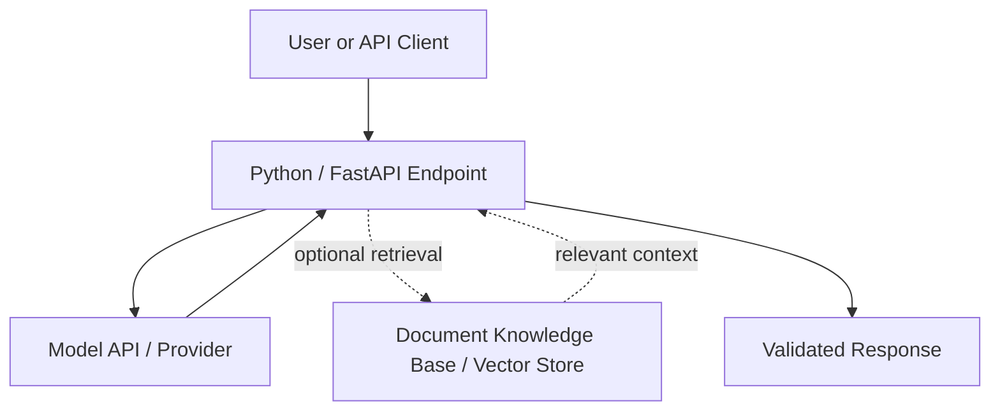

# AI Foundation — Techlambda

**Common AI Foundation | 10 Hours | 5 Modules | 5 Sessions × 2 Hours**

A practical, instructor-led foundation course that moves learners from understanding AI concepts to building a small AI-powered Python application. This README follows **Part A — Common AI Foundation (10 Hours)** of the supplied *AI Foundation + AI Infrastructure & Agentic Systems* training TOC.

> **Scope:** This repository README describes the **foundation course only (Modules 1–5)**. It does not define or claim delivery of any role-specific specialization.

## 1. Course Overview

| Item | Details |
|---|---|
| Course name | Common AI Foundation |
| Duration | **10 hours** |
| Modules | **5** |
| Delivery | **5 instructor-led sessions × 2 hours** |
| Method | Practical-first, instructor-led demonstrations and guided labs |
| Learning mix | **30% theory / 70% hands-on** (delivery target) |
| Learning cycle | Discover → Design → Deliver → Practice → Assess → Improve |
| Exit project | Small Python AI assistant with an API and optional RAG |

### Objectives

By the end of the course, learners should be able to:

1. Distinguish AI, Machine Learning, Deep Learning and Generative AI, and explain models, training, inference, tokens and embeddings.
2. Explain LLM behavior; write reliable prompts, request structured outputs and recognize responsible-AI risks.
3. Integrate a hosted language model into Python and expose a basic AI endpoint using FastAPI.
4. Explain and demonstrate embeddings, semantic/vector search and a simple Retrieval-Augmented Generation (RAG) pipeline.
5. Describe a basic AI application architecture and build a foundation capstone connecting an API, model and optional knowledge base.

**Boundary:** These 10 hours provide foundational knowledge and implementation practice; they do not by themselves establish specialist production-engineering readiness.

## 2. Intended Audience and Prerequisites

**Audience:** Technical learners, engineers and corporate trainers beginning hands-on AI application development.

**Assumed knowledge:**
- Programming fundamentals and basic Python familiarity.
- Basic command-line usage.
- HTTP/REST and Git/GitHub fundamentals are helpful.

**Learning environment:**
- Python 3.x, VS Code (or similar editor), Git/GitHub and a browser.
- Access to at least one hosted LLM API.
- Python virtual environment; FastAPI for API labs.
- Sample documents and a local vector store/vector database for the RAG lab.
- Postman/equivalent API client and Jupyter are optional.

Keep API keys in environment variables; never commit credentials or private data to the repository.

## 3. Foundation TOC — 5 Modules / 10 Hours

| Session | Module | Duration | Expected hands-on evidence |
|---|---|---:|---|
| 01 | **M01 — AI, ML, Deep Learning & Generative AI Foundations** | 2h | AI use-case map and model comparison notes |
| 02 | **M02 — LLMs, Prompt Engineering & Responsible AI** | 2h | Reusable prompt library |
| 03 | **M03 — Python, APIs & AI Application Integration** | 2h | Working Python AI service |
| 04 | **M04 — Embeddings, Vector Search & RAG** | 2h | Working basic RAG demonstration |
| 05 | **M05 — AI Application Architecture & Foundation Capstone** | 2h | Foundation capstone and architecture diagram |
| | **Total** | **10h** | |

### M01 — AI, ML, Deep Learning & Generative AI Foundations (2h)

**Why:** Build a correct mental model of modern AI systems before using them.

**Core topics:** AI vs ML vs DL vs GenAI; supervised, unsupervised and reinforcement learning; training vs inference; models, parameters, weights and datasets; foundation models; transformers; tokens and context windows; embeddings; multimodal AI; hosted vs local vs open models; LLMs vs SLMs.

**Analogy:** AI is a company; ML is a department, Deep Learning a specialist team and Generative AI a team that creates outputs.

**Labs:**
- Compare responses from multiple models.
- Experiment with tokens and context windows.
- Map familiar technical tasks to potential AI use cases.

**Outcome / validation:** Explain core AI terminology and distinguish training from inference.

**Evidence:** Use-case map and model comparison notes.

### M02 — LLMs, Prompt Engineering & Responsible AI (2h)

**Why:** Better instructions, grounding, validation and safe handling produce more reliable outputs.

**Core topics:** System/user/tool roles; zero-shot, one-shot and few-shot prompts; role prompting; structured outputs; prompt templates; task decomposition; hallucination and grounding; prompt injection; privacy and data handling; responsible AI; human-in-the-loop.

**Analogy:** An LLM is a capable junior consultant that needs clear goals, context, constraints and review.

**Labs:**
- Create a technical troubleshooting prompt and a reusable runbook-generation prompt.
- Ask for a structured JSON response and check its validity.
- Compare weak and improved prompts.
- Perform a prompt-injection awareness exercise.

**Outcome / validation:** Build and explain reusable prompts with constraints and output checks.

**Evidence:** Personal prompt library.

### M03 — Python, APIs & AI Application Integration (2h)

**Why:** Move from using an AI interface to integrating a model into a real application.

**Core topics:** Python refresh; virtual environments; JSON, HTTP and REST; LLM API invocation; API keys and environment variables; error handling, timeouts and retries; structured response parsing; FastAPI basics.

**Analogy:** A model API is a service counter: an application sends a structured request and receives a structured response.

**Labs:**
- Create a Python LLM client.
- Read API keys from environment variables.
- Parse structured responses.
- Expose a simple AI endpoint.

**Outcome / validation:** Demonstrate an API-driven AI application with basic error handling.

**Evidence:** Working Python AI service.

### M04 — Embeddings, Vector Search & RAG (2h)

**Why:** Connect model-generated answers to relevant external knowledge.

**Core topics:** Embeddings; semantic similarity; vector databases; chunking; metadata; retrieval; generation; RAG architecture; RAG vs fine-tuning; common RAG failure modes.

**Analogy:** RAG is an open-book exam: the knowledge base is the library, retrieval finds useful pages and the model writes a response using them.

**Labs:**
- Ingest sample documents and create embeddings.
- Run semantic search.
- Assemble a basic document-question-answering pipeline.

**Outcome / validation:** Explain and demonstrate retrieval plus answer generation.

**Evidence:** Working basic RAG demo.

### M05 — AI Application Architecture & Foundation Capstone (2h)

**Why:** Connect the foundation concepts into a small end-to-end application.

**Core topics:** UI/API layer; model provider/runtime; model abstraction; RAG/knowledge layer; security; observability; cost; local vs hosted model decisions.

**Analogy:** An AI solution is still an application architecture; the model is one component inside it.

**Lab:** Build and explain a small Python AI assistant with an API and **optional RAG**.

**Outcome / validation:** Demonstrate how the API, model, optional knowledge source and basic safeguards fit together.

**Evidence:** Foundation capstone and architecture diagram.

## 4. Foundation Architecture

The **minimal capstone** requires a working Python endpoint that calls a model and returns a response. Adding document retrieval is an optional extension, consistent with the source TOC.

## 5. Training Methodology

Each module follows the Techlambda learning cycle:

**What → Why → Real-Life Analogy → Assumptions → Prerequisites → How → Core Concepts → Architecture/Flow → Demo → Hands-on Lab → Outcome → Validation → Evidence → Common Mistakes → Troubleshooting → Knowledge Check → Assignment/Practice → Next Topic**

The 30/70 ratio is a **delivery goal**, not a claim that all session materials have already been timed or tested. Each delivered session should record learner lab time and demonstrable outputs.

See [Techlambda Content and Quality Standard](docs/TRAINING-STANDARD.md) for detailed content and review criteria.

## 6. Assessments and Completion Evidence

The source TOC expects hands-on checks, oral knowledge checks, lab validation, troubleshooting and architecture discussion. For the foundation course, collect:

- **M01:** Use-case map and model comparison.
- **M02:** Prompt library with structured-output and safety exercises.
- **M03:** Python AI API source, startup steps and a verified example response.
- **M04:** Sample-document RAG demo and test questions.
- **M05:** Small AI assistant, architecture diagram and short walkthrough.

**Foundation exit check:** The learner can explain the core concepts, invoke a model from Python, demonstrate simple retrieval and explain the capstone architecture. Report missing or untested evidence explicitly rather than marking the course complete.

## 7. Repository Status

**Status: Documentation baseline — implementation not yet validated.**

This README is aligned to the foundation portion of the supplied TOC. It is **not** evidence that runnable labs, teaching notes, automated tests or the capstone have already been implemented. The repository also contains broader planning documents; those do not change the scope of this foundation-only README.

**Next planned delivery:** M01 lesson materials, analogy and visual flow, guided experiments, expected results, knowledge checks and validated evidence.

---

**Maintained by Techlambda.**