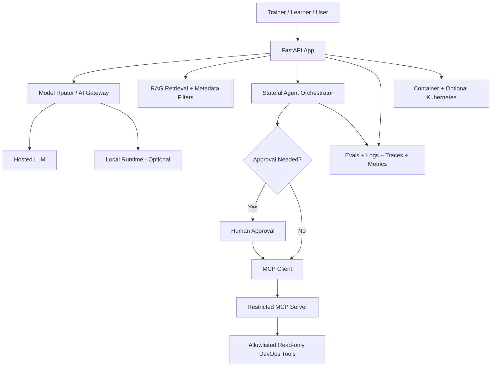

# Progressive capstone: AI Infrastructure & Agentic Operations Assistant

The source TOC proposes an assistant connecting an application, model router, local/hosted inference, RAG, stateful agents, MCP tools, Linux/DevOps systems, and observability. This file converts that **proposed** scope into an incremental teaching architecture; it is not an implementation claim.

## Safety defaults
- Start read-only: e.g. fetch synthetic service status, search approved runbooks or inspect sample logs.
- Require a human approval gate before any state-changing action; no unrestricted shell executor.
- MCP tools have explicit scopes, parameter validation, timeouts and audit entries.
- Tenant/document metadata isolation is tested before demonstrating multi-user RAG.
- Use synthetic or public sample data; no production customer data or credentials.
- Observe token usage, latency, error rate, model fallback and tool-invocation results.

## Planned deliverables
Architecture diagram, Python API, RAG, agent with durable state, MCP server/client, Docker service, golden-set evaluations, traces/metrics, security checklist, troubleshooting notes, README and teach-back script.

## Verification
An implemented capstone is only complete after a fresh-clone setup, successful functional + failure tests, security checks, and a reproducible learner demonstration.
